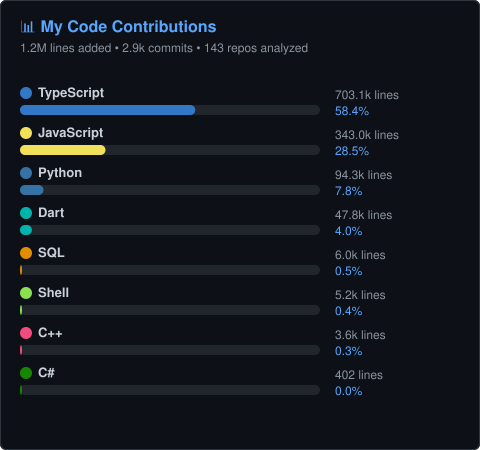
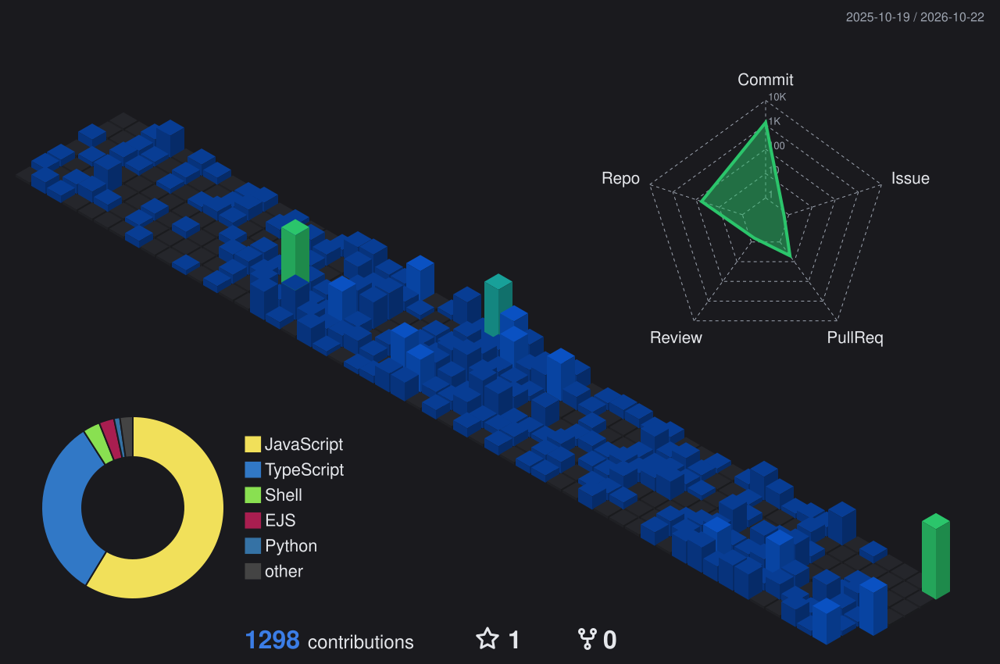

 

---

## 📊 Code Statistics

  

  

---

## 🏙️ Contribution City

<b>🐍 Snake mode</b>

 

<picture>
  <source media="(prefers-color-scheme: dark)" srcset="https://raw.githubusercontent.com/BassRhombus/BassRhombus/output/snake-dark.svg" />
  <source media="(prefers-color-scheme: light)" srcset="https://raw.githubusercontent.com/BassRhombus/BassRhombus/output/snake.svg" />
  
</picture>

---

## 📈 Activity

---

<!-- CONNECT4:START -->

## 🎮 Community Connect Four

**Anyone can play!** Click a column number to drop the next piece. Everyone plays together, taking turns for whichever team is up.

It's **🔵 Blue's** turn · move #1

| [**1**](https://github.com/BassRhombus/BassRhombus/issues/new?title=connect4%7Cdrop%7C1&body=Just%20press%20%2A%2ACreate%2A%2A%20%E2%80%94%20don%27t%20change%20the%20title.%20A%20bot%20will%20drop%20your%20piece%20within%20a%20minute.) | [**2**](https://github.com/BassRhombus/BassRhombus/issues/new?title=connect4%7Cdrop%7C2&body=Just%20press%20%2A%2ACreate%2A%2A%20%E2%80%94%20don%27t%20change%20the%20title.%20A%20bot%20will%20drop%20your%20piece%20within%20a%20minute.) | [**3**](https://github.com/BassRhombus/BassRhombus/issues/new?title=connect4%7Cdrop%7C3&body=Just%20press%20%2A%2ACreate%2A%2A%20%E2%80%94%20don%27t%20change%20the%20title.%20A%20bot%20will%20drop%20your%20piece%20within%20a%20minute.) | [**4**](https://github.com/BassRhombus/BassRhombus/issues/new?title=connect4%7Cdrop%7C4&body=Just%20press%20%2A%2ACreate%2A%2A%20%E2%80%94%20don%27t%20change%20the%20title.%20A%20bot%20will%20drop%20your%20piece%20within%20a%20minute.) | [**5**](https://github.com/BassRhombus/BassRhombus/issues/new?title=connect4%7Cdrop%7C5&body=Just%20press%20%2A%2ACreate%2A%2A%20%E2%80%94%20don%27t%20change%20the%20title.%20A%20bot%20will%20drop%20your%20piece%20within%20a%20minute.) | [**6**](https://github.com/BassRhombus/BassRhombus/issues/new?title=connect4%7Cdrop%7C6&body=Just%20press%20%2A%2ACreate%2A%2A%20%E2%80%94%20don%27t%20change%20the%20title.%20A%20bot%20will%20drop%20your%20piece%20within%20a%20minute.) | [**7**](https://github.com/BassRhombus/BassRhombus/issues/new?title=connect4%7Cdrop%7C7&body=Just%20press%20%2A%2ACreate%2A%2A%20%E2%80%94%20don%27t%20change%20the%20title.%20A%20bot%20will%20drop%20your%20piece%20within%20a%20minute.) |
|:-:|:-:|:-:|:-:|:-:|:-:|:-:|
| ⚫ | ⚫ | ⚫ | ⚫ | ⚫ | ⚫ | ⚫ |
| ⚫ | ⚫ | ⚫ | ⚫ | ⚫ | ⚫ | ⚫ |
| ⚫ | ⚫ | ⚫ | ⚫ | ⚫ | ⚫ | ⚫ |
| ⚫ | ⚫ | ⚫ | ⚫ | ⚫ | ⚫ | ⚫ |
| ⚫ | ⚫ | ⚫ | ⚫ | ⚫ | ⚫ | ⚫ |
| ⚫ | ⚫ | ⚫ | ⚫ | ⚫ | ⚫ | ⚫ |

🔵 Blue **0** · 🟢 Green **0** · 🤝 Draws **0**

<!-- CONNECT4:END -->

---

## 🛰️ GitHub Metrics

---

## 🧠 Tech Stack

<b>💻 Languages</b>

 

| Core | Scripting | Data |
|:----:|:---------:|:----:|
|  |  |  |
|  |  |  |
|  |  | |

<b>🖥️ Frontend & Apps</b>

 

<b>🎮 Game Development</b>

 

<b>🤖 Bots & Automation</b>

 

<b>🗄️ Databases</b>

 

<b>☁️ DevOps & Infrastructure</b>

 

<b>🛠️ Tools & Workflow</b>

 

---

